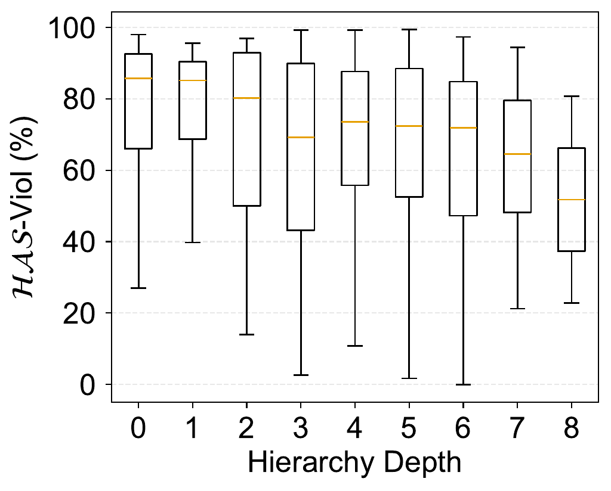
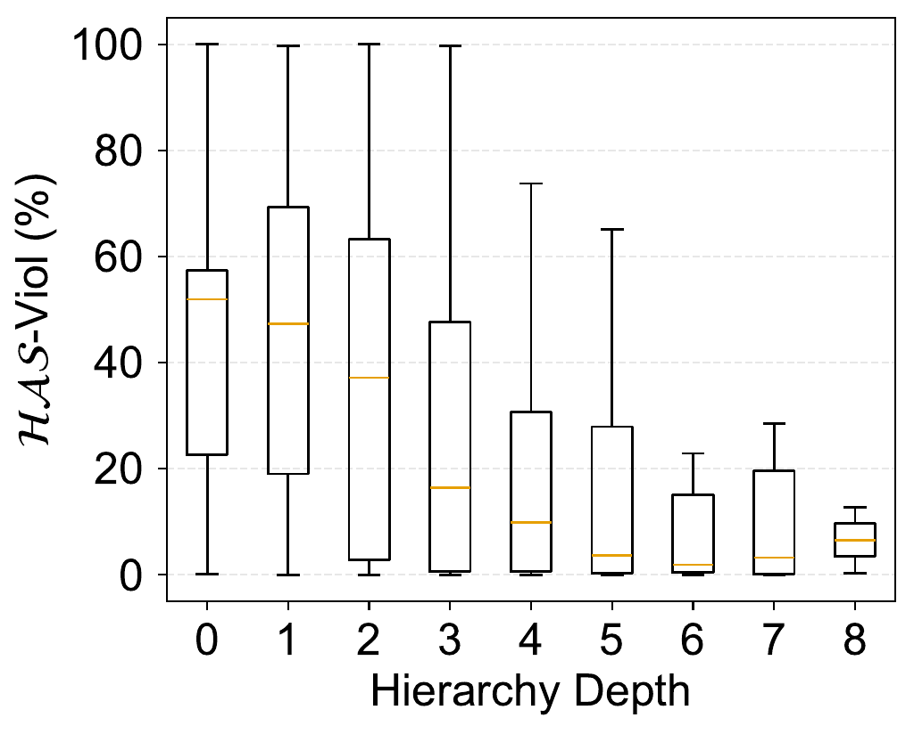
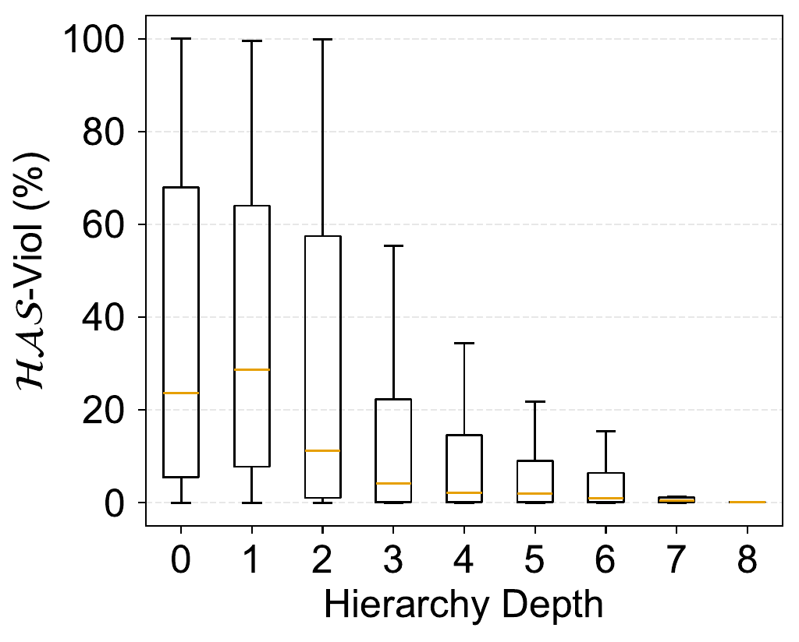
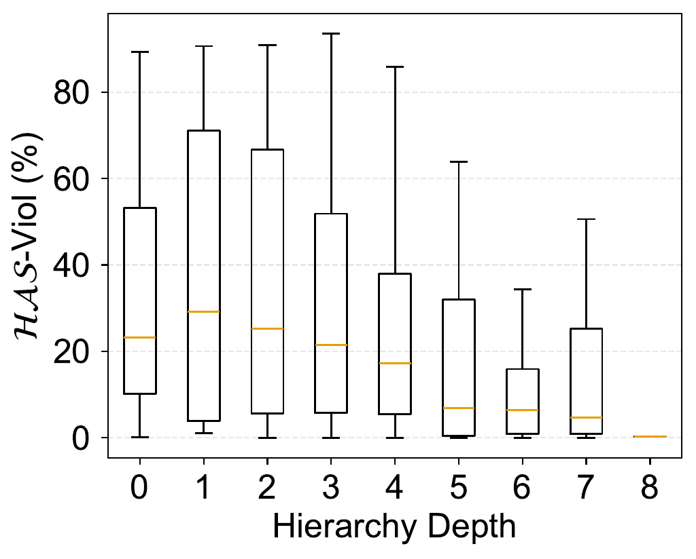
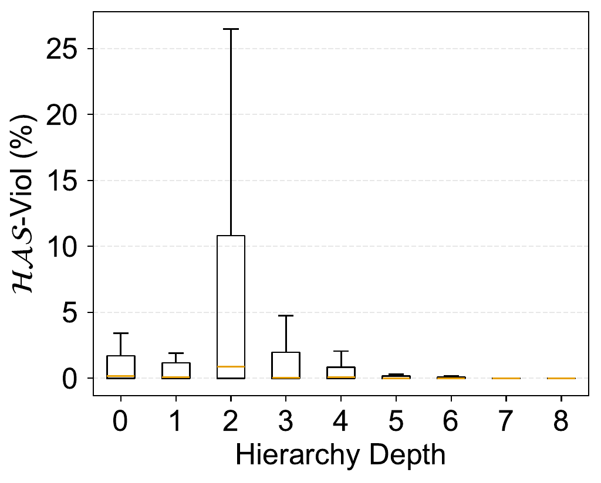
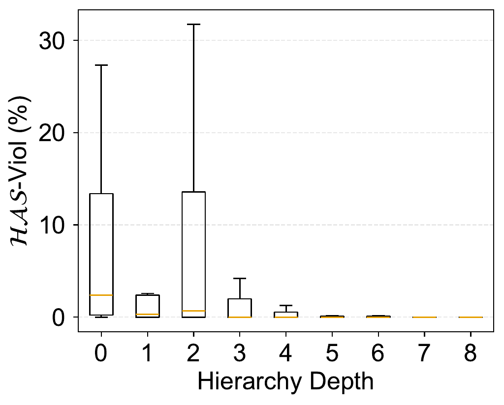
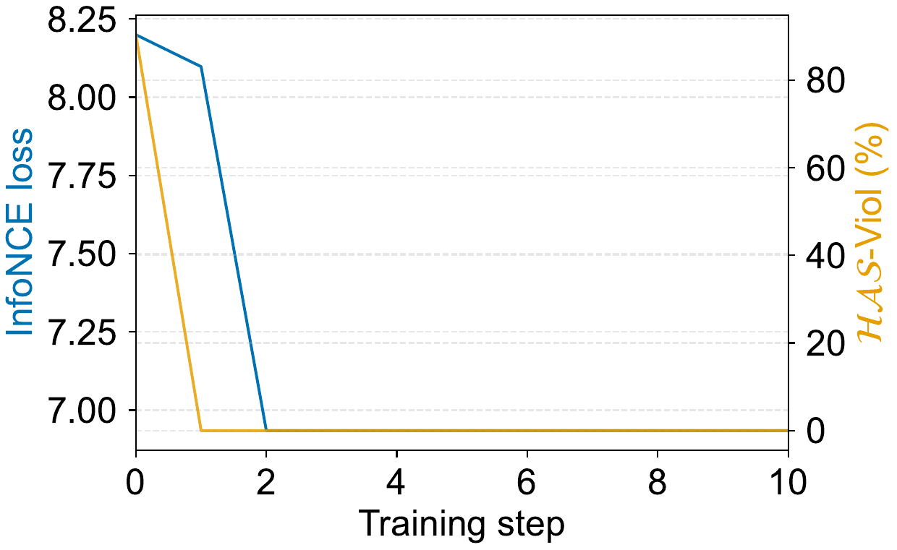
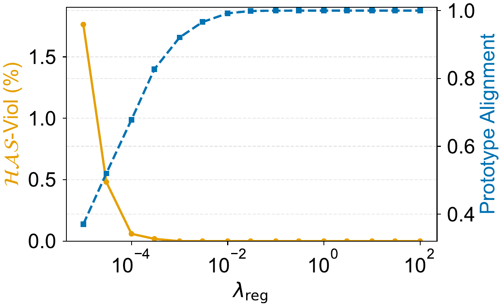

# Hierarchical Angular Separation

Code for **[Provable Cross-Modal Transfer of Hierarchical Concept Structure in CLIP Embeddings](https://openreview.net/forum?id=IFmLNK0lpW)** (NeurIPS 2026).

Hierarchical Angular Separation (HAS) means that a concept embedding is closer in angle to its descendants than to concepts on unrelated branches. The HAS violation percentage (HAS-Viol) measures how far embeddings depart from this. For each concept, it is the percentage of off-branch concepts that are at least as similar to the concept as its least similar descendant. Off-branch concepts exclude the concept's own subtree and its ancestors.

Run the experiments below to generate the paper's empirical figures and table from ImageNet and synthetic data.

| Experiment | Comparison | Output directory |
| --- | --- | --- |
| Image and text hierarchy | Random, OpenAI, and DataComp CLIP embeddings | `results/figure2/` |
| Image hierarchy versus shuffled controls | Image-side HAS violations for each representation and its matched control | `results/table1/` |
| Synthetic InfoNCE transfer | HAS transfer during optimization and across regularization strengths | `results/synthetic/plots/` |

## Installation

Use Python 3.12 and run these commands from the repository root:

```bash
git clone https://github.com/nghiahhnguyen/hierarchical-angular-separation.git
cd hierarchical-angular-separation
python3.12 -m venv .venv
source .venv/bin/activate
python -m pip install -r requirements.txt
```

Use a CUDA-enabled PyTorch installation on Linux for GPU runs. To check the installation:

```bash
python -m pytest -q
```

## Prepare ImageNet

The real-data experiments use the **ImageNet-1K training split**. Obtain `ILSVRC2012_img_train.tar` from the [official ImageNet download page](https://image-net.org/download.php), following its access and usage terms.

Extract the outer archive and its class archives:

```bash
mkdir -p /path/to/imagenet/train
tar -xf /path/to/ILSVRC2012_img_train.tar -C /path/to/imagenet/train
for archive in /path/to/imagenet/train/*.tar; do
    class_dir="${archive%.tar}"
    mkdir -p "$class_dir"
    tar -xf "$archive" -C "$class_dir"
done
export IMAGENET_ROOT=/path/to/imagenet
```

The expected layout is `imagenet/train/<synset>/*.JPEG`, for example `imagenet/train/n01440764/n01440764_10026.JPEG`.

The required [hierarchy metadata](data/imagenet_hierarchy.json), class names, and prompt templates are included. No separate WordNet download is needed. Pretrained weights download automatically through [OpenAI CLIP](https://github.com/openai/CLIP) and [OpenCLIP](https://github.com/mlfoundations/open_clip) on first use. Model identifiers and measurement details are in the [experiment notes](docs/experiments.md).

## HAS measurements on ImageNet

Run the complete real-data workflow inside your compute allocation:

```bash
IMAGENET_ROOT=/path/to/imagenet DEVICE=cuda bash scripts/run_real_data.sh
```

The script extracts features from all training images, then plots image and text hierarchy and tabulates the shuffled-control comparisons. Features are cached locally under `results/cache/` for reuse. You can also extract one model at a time:

```bash
python -m has.real_data extract \
    --imagenet-root "$IMAGENET_ROOT" \
    --model openai --device cuda --batch-size 32
```

After the full extraction script has created the required caches, rerun either measurement separately:

```bash
python -m has.real_data figure2
python -m has.real_data table1
```

The image and text hierarchy plots are written as `results/figure2/figure2.png` and `figure2.pdf`. The shuffled-control comparisons are written as `results/table1/table1.md` and `table1.tex`. Both experiments also write their numeric measurements as JSON.

### Image and text hierarchy

The paper reports these results. Each panel shows the distribution of HAS-Viol by hierarchy depth for ViT-L/14 embeddings, over concepts that are neither the root nor a leaf. To reduce the effect of outliers, the least similar descendant is replaced by the 95th percentile of descendant similarities.

|  | Randomly initialized | OpenAI CLIP | OpenCLIP (DataComp-1B) |
| --- | --- | --- | --- |
| **Text** |  |  |  |
| **Image** |  |  |  |

Text embeddings acquire HAS through pretraining. Image embeddings show approximate HAS at random initialization and stronger HAS after pretraining.

### Image hierarchy versus shuffled controls

The paper reports this table of mean image-side HAS-Viol. Each representation is compared with a control that shuffles the leaves within the same hierarchy. Values after ± are standard deviations over random seeds or shuffles. The [experiment notes](docs/experiments.md) give the spread for each row. Fresh runs can differ from these values in the last digits.

| Representation | HAS-Viol (%) ↓ | HAS-Viol shuffled (%) ↓ |
| --- | --- | --- |
| Raw pixels | 26.51 | 50.95 ± 0.29 |
| Randomly initialized ViT-L/14 | 27.88 ± 0.24 | 56.80 ± 0.42 |
| Pretrained OpenAI CLIP ViT-L/14 | 2.95 | 32.93 ± 0.48 |
| i.i.d. Gaussian vectors (d = 768) | 76.02 ± 0.97 | 76.33 ± 0.93 |

Raw pixels and randomly initialized image embeddings have far fewer violations than their shuffled controls. Gaussian vectors do not, so approximate image-side HAS comes from the image data itself.

## HAS transfer under InfoNCE

The synthetic data are generated locally; no external download is needed. Start with the small training check:

```bash
bash scripts/smoke_synthetic.sh
```

Run the complete synthetic experiment inside your compute allocation:

```bash
DEVICE=cuda bash scripts/run_figure5.sh
```

The script generates data, optimizes the text embeddings, and plots the convergence trace and regularization sweep. It writes measurements, checkpoints, and plots under `results/synthetic/`. Use a fresh directory for each rerun, for example `RUN_ROOT=results/synthetic-rerun`.

### Synthetic InfoNCE transfer

The paper reports these results. The image embeddings are fixed, and the text embeddings minimize InfoNCE with a regularization term weighted by λ.

| Convergence at λ = 10⁻³ | Regularization sweep over λ ∈ [10⁻⁵, 10²] |
| --- | --- |
|  |  |

The left panel shows the InfoNCE loss without the regularization term, and the text-side HAS-Viol, at each L-BFGS step. The right panel shows results at the minimizer. Prototype alignment is the smallest cosine, over non-root concepts, between a concept's optimal text embedding and its image prototype. Text-side HAS-Viol reaches zero at a smaller λ than prototype alignment needs to saturate.

The panel-specific settings are listed in the [experiment notes](docs/experiments.md). For individual options, use `python synthetic/run_experiment.py single --help` or `sweep --help`.
